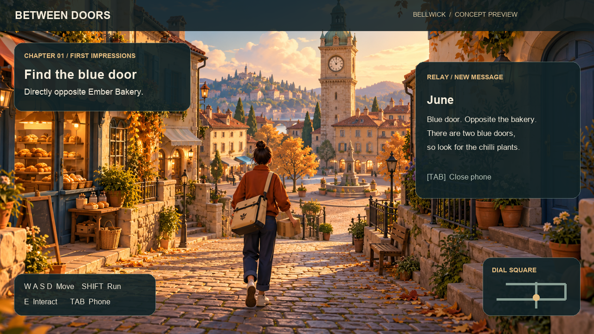
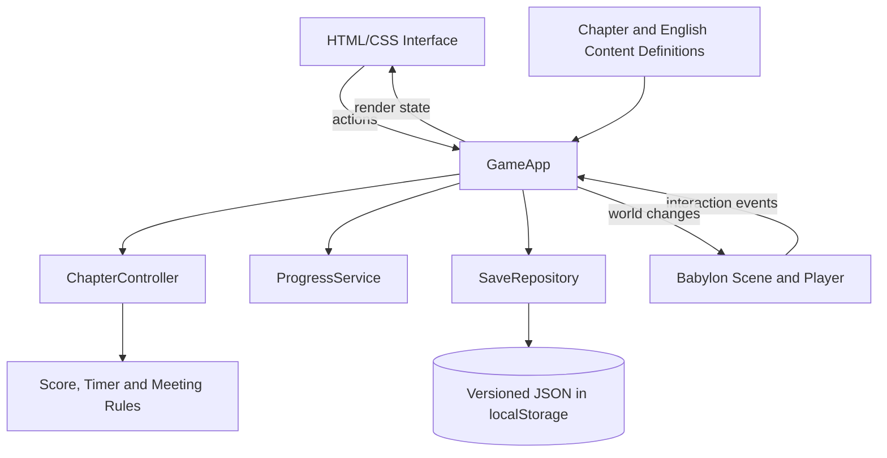
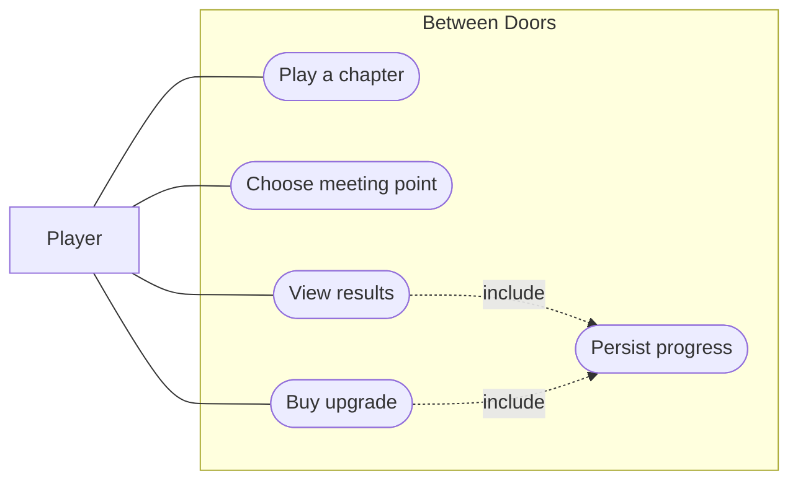
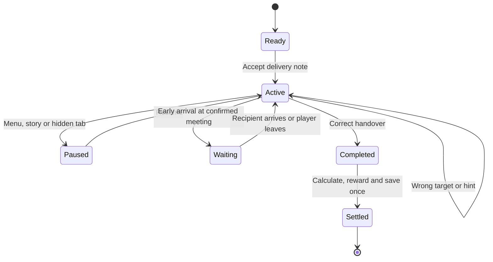
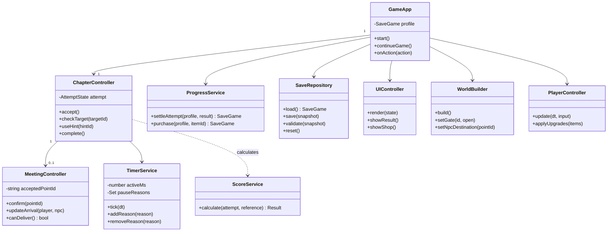
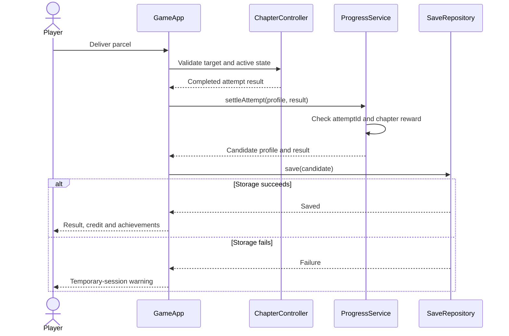
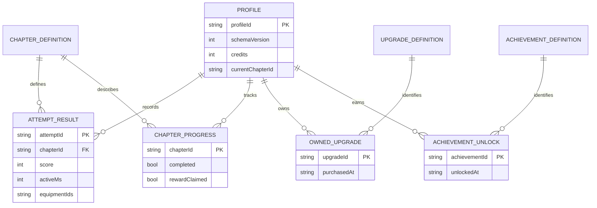

# Between Doors

### Every delivery brings someone closer.

**A third-person neighbourhood delivery game about finding people, choosing meeting places and learning the streets between them.**

> **GMT 458 · Web GIS course project — Design submission**  
> **Status:** Pre-development. This repository documents the proposed game; a playable build is not yet available. All gameplay features below are planned unless explicitly labelled otherwise.



*Visual concept only: an AI-generated environment with separately composed interface overlays. The planned course build will use much simpler low-poly architecture. This image is not a gameplay screenshot; the pictured live minimap is outside the current scope.*

## Contents

- [Overview](#overview)
- [Story and characters](#story-and-characters)
- [Three-chapter experience](#three-chapter-experience)
- [Gameplay and controls](#gameplay-and-controls)
- [Score, credits and upgrades](#score-credits-and-upgrades)
- [Achievements](#achievements)
- [Spatial thinking and originality](#spatial-thinking-and-originality)
- [Requirements and acceptance criteria](#requirements-and-acceptance-criteria)
- [Technical architecture](#technical-architecture)
- [UML diagrams](#uml-diagrams)
- [Data and persistence](#data-and-persistence)
- [Planned project structure](#planned-project-structure)
- [Development plan](#development-plan)
- [Documentation and references](#documentation-and-references)

## Overview

| Item | Current design |
|---|---|
| Genre | Single-player exploration, light spatial puzzles and story |
| Perspective | Third-person, behind-the-character camera |
| Setting | Bellwick, a compact fictional neighbourhood |
| Target platform | Desktop browser; keyboard and mouse |
| Language | English interface, dialogue and signs |
| Scope | Three short chapters in one reusable scene |
| Target playtime | Approximately 10–15 minutes; to be validated through testing |
| Art direction | Simple stylised low-poly models, fixed afternoon lighting |
| Progression | Performance score, credits, two upgrades and four achievements |
| Course | GMT 458 — Web GIS |

**Core loop:** Collect a parcel → read the delivery note → investigate or arrange a meeting → find the recipient → deliver → receive feedback and credits → choose an upgrade.

The first release prioritises a complete short experience over a large world. It does not include combat, vehicles, multiplayer, building interiors, complex parcel physics, procedural missions or a live GPS service.

## Story and characters

Alex arrives for a first courier shift in Bellwick. The navigation app announces arrival in front of a blank wall. Mara calls from the nearby delivery shop:

> “First shift? Over here. The map likes that wall.”

Street numbers have changed, local directions rely on landmarks, and one old lane is missing from the map. Alex gradually learns how the neighbourhood fits together.

The apparently ordinary parcels contribute to a small gathering for **Arthur Reed**, Bellwick’s retired postman, on the anniversary of his first postal shift. The final parcel is an album of photographs and residents’ notes. Reaching Arthur’s overlooked home brings the day’s tasks together.

| Character | Role |
|---|---|
| **Alex** | The player’s courier; unfamiliar with Bellwick at the beginning |
| **Mara** | Owner of **Relay**, the delivery shop; coordinates the gathering |
| **June** | The first recipient; contributes a photograph to the album |
| **Finn** | A walking customer; agrees on a meeting point with the player |
| **Arthur Reed** | The retired postman; encountered briefly before the final delivery |
| **Sylvie** | Supplies an old photograph and a note; does not require a separate animated NPC |

June is a resident in this simplified version, not the owner of Ember Bakery. The bakery remains a visual landmark.

**Ending:** Arthur receives the album. A short exchange leads into a static illustration of the neighbours gathered around a small table, accompanied by music. The player’s own sketch map gains Postmark Mews. The game treats this as a renewed connection, not an instant solution to loneliness.

## Three-chapter experience

### 1. First Impressions — Read the place

**Objective:** Deliver June’s parcel to the correct blue door.

> “Blue door, directly opposite Ember Bakery. Look for the chilli plants.”

- Find the bakery and compare two blue doors.
- Use both spatial relationship and the visible plants to identify one correct target.
- Knock, confirm the recipient and hand over the parcel.
- A distinct wrong door costs score but does not lose the parcel or reset the mission.
- June contributes a photograph envelope for Mara. The unscored return introduces Arthur briefly.

**Introduces:** Movement, camera, task panel, interaction and landmark-based reasoning.

### 2. Crossing Paths — Choose the meeting

**Objective:** Deliver gathering decorations to Finn.

> “Walking towards Dial Square. Red jacket, green bag. Where should we meet?”

The player chooses between:

| Meeting point | Trade-off |
|---|---|
| **The fountain in Dial Square** | Familiar and easy to recognise, but reached by a slightly longer route |
| **Crossing Yard** | Closer, but requires finding its signed entrance and opening the courtyard gate |

Finn follows a simple authored route, accepts one meeting and waits at its destination. He stops for interaction; missing him does not fail the chapter. Once confirmed, the meeting cannot be changed in this first release.

Both routes must be viable. After delivery, the courtyard shortcut becomes available regardless of the player’s choice. If the player arrives early at the confirmed meeting point, unavoidable recipient waiting is excluded from active performance time.

The decorations carry the words **“Forty years. Thousands of doors.”** Mara explains the gathering. The chapter demonstrates the game’s main differentiator: the player helps decide **where** delivery happens.

### 3. Between Doors — Find the forgotten address

**Objective:** Deliver the completed album to Arthur at **Postmark Mews, last house on the lane**.

The phone reports **“Address not found.”** Mara supplies the old gate key before departure. Sylvie’s photograph shows a broken stone wall, a leaning tree and a faded postal sign.

The player compares the photo with the present-day scene, identifies the entrance, inspects the sign, opens the gate and reaches Arthur. No image-recognition software or pixel-perfect camera alignment is needed.

> Arthur: “Who told you the way?”  
> Alex: “The neighbourhood did.”

The handover stops performance timing. The album reveal, final dialogue and gathering illustration play before the overall results and final achievement notification.

## Gameplay and controls

| Input | Action |
|---|---|
| W / A / S / D | Move relative to the camera |
| Mouse | Rotate the third-person camera |
| Shift | Run |
| E | Contextual interaction: inspect, knock, talk or deliver |
| Tab | Open or close the single delivery panel |
| M | Open or close the static neighbourhood sketch |
| Esc | Pause and settings |

### Simplified presentation

- One square, two short streets, one courtyard and a short final lane.
- Approximately 6–8 building facades assembled from 2–3 reusable models.
- Keep clue objects; remove nonessential balconies, gutters and small architectural detail.
- A ready-made courier model with idle/walk animation; running may reuse a faster animation cycle.
- One task panel contains notes, a photograph, hints and at most two responses.
- A static sketch replaces live minimap, route calculation and map-pin tools.
- A parcel is an inventory state and bag visual, not a simulated physical object.
- Short text dialogue replaces voice acting and cinematic conversation cameras.
- Fixed afternoon light; a static ending illustration replaces a crowd sequence.

Basic map access, readable text and accessibility settings are available without purchasing upgrades.

## Score, credits and upgrades

### Performance score

Each chapter starts with **1,000 base points**.

```text
baseScore = max(100, 1000 - 100 × distinctWrongTargets - hintCosts)
chapterScore = baseScore + timeBonus
```

- A distinct wrong door or explicit wrong-recipient check costs **100 points**.
- Repeating the same wrong target during the same attempt causes no further deduction.
- Simply walking past a person does not count as checking them.
- Two sequential hints cost **50** and **100** points respectively; reopening a used hint is free.
- Reading the note or photograph again and negotiating the normal meeting are not paid hints.

There is **no forced deadline**. For active time `T` and a chapter-specific reference time `R`:

| Active time | Bonus |
|---|---:|
| `T ≤ R` | +200 |
| `R < T ≤ 1.5R` | +150 |
| `1.5R < T ≤ 2R` | +100 |
| `T > 2R` | +0 |

Reference times will be established through playtesting. Maximum score is **1,200 per chapter** and **3,600 overall**.

Movement, searching, map use and delivery-note reading count as active time. Pause, mandatory story scenes, between-chapter returns and unavoidable waiting at the confirmed meeting point do not. Hidden tabs pause the simulation. Overlapping time exclusions must never be subtracted twice.

### Credits and upgrade cards

Credits are separate from performance points. Each chapter’s **first completion grants 100 credits**, even after a poor performance. Replays do not grant more credits.

| Upgrade | Cost | Planned effect |
|---|---:|---|
| **Compass** | 100 credits | Adds a simple north indicator; does not reveal the target |
| **Steady Pace** | 100 credits | Slightly increases running speed; initial tuning proposal: +10% |

After Chapters 1 and 2, two purchase cards appear. Owned items cannot be bought again, and continuing without a purchase is allowed. Both upgrades are optional for completion. The full game grants 300 credits and the two products cost 200; the remaining balance does not imply additional promised products.

Results retain the equipped upgrades so attempts with different movement abilities are not presented as identical conditions. A separate three-star system is outside this simplified release.

## Achievements

| Achievement | Unlock condition |
|---|---|
| **First Delivery** | Complete Chapter 1 |
| **Clean Shift** | Finish any chapter with no wrong-target checks; hints do not invalidate this achievement |
| **Meet Me Halfway** | Arrange Finn’s meeting and complete the handover |
| **Special Delivery** | Deliver Arthur’s album |

Achievements unlock once and persist locally. The final achievement appears after the ending, not over Arthur’s dialogue.

## Spatial thinking and originality

The game uses landmark relationships, visual comparison, route choice, meeting accessibility and learned shortcuts. Players apply spatial reasoning without needing engineering knowledge.

Delivery and address-clue puzzles have existing precedents, particularly **Letters to Arralla**. **Lake** also connects postal work with community stories. This project does not claim to invent those ideas.

Its intended identity is the combination of:

1. Interpreting informal directions.
2. Choosing a meeting point for a moving recipient.
3. Reusing knowledge of a compact neighbourhood.
4. Connecting deliveries to one human story.

The two meeting options must change the player’s route and actions, not merely change dialogue.

**Course dependency:** The proposed setting uses fictional local coordinates. Whether GMT 458 requires actual geographic data or a particular mapping library must be checked against the assignment; fictional 3D space alone does not establish compliance.

## Requirements and acceptance criteria

### Functional requirements

| ID | Requirement | Acceptance criterion |
|---|---|---|
| FR-01 | Start, continue and chapter access | A new profile starts at Chapter 1; later chapters unlock after completion |
| FR-02 | Third-person movement | Character moves, runs and collides with simple obstacles; camera stays usable |
| FR-03 | Contextual interaction | Only an eligible nearby target responds; the action label is visible |
| FR-04 | Single task panel | Notes and required clues can be reopened without duplicate charges |
| FR-05 | Static map | Map opens independently and gains the final lane only after discovery |
| FR-06 | Chapter flow | Parcel collection precedes handover; completion cannot settle twice |
| FR-07 | Meeting choice | Both options send Finn to the correct reachable point, where he waits |
| FR-08 | Shortcut | Crossing Yard is available at the start of Chapter 3 for either prior choice |
| FR-09 | Photo and key | The final entrance is identifiable without hidden information; the key opens the intended gate |
| FR-10 | Story and ending | Required conversations and the static finale play in the intended order |
| FR-11 | Wrong-target penalties | Each target is penalised only once per attempt |
| FR-12 | Hints | Two sequential hints cost 50/100 once each |
| FR-13 | Timing | Pauses and protected waiting do not inflate active time |
| FR-14 | Score | Formula and all boundary values produce the defined result |
| FR-15 | Credits | Each chapter grants its first-completion reward only once |
| FR-16 | Purchases | Invalid, unaffordable or already-owned purchases are rejected |
| FR-17 | Upgrade effects | Compass shows direction; speed affects running only |
| FR-18 | Achievements | Four conditions unlock once; final notification is deferred |
| FR-19 | Save | Completion, purchases and achievements persist in a validated local snapshot |
| FR-20 | Replay | Chapter state resets while profile progression remains; no repeat credit farming |

### Quality requirements

| ID | Requirement |
|---|---|
| NFR-01 | Reproducible install/build using pinned dependencies and a committed lockfile once implementation exists |
| NFR-02 | Target at least 30 FPS at 1280×720 on the documented course test device; this is a target, not an achieved measurement |
| NFR-03 | Validate the complete flow on the selected desktop browsers, including Safari; show a readable graphics/load error |
| NFR-04 | Readable text, non-colour-only clues, camera sensitivity and music-volume controls |
| NFR-05 | Loading indication and recoverable asset errors; failed loads never count as completed chapters |
| NFR-06 | No account, precise GPS, email collection or cloud database |
| NFR-07 | Detect invalid saves and storage failures; do not silently erase progress |
| NFR-08 | Keep scoring/progression independent of rendering; avoid duplicating rules in UI code |
| NFR-09 | Record model, image and audio sources and usage rights |

## Technical architecture

**Proposed stack, not installed implementation:**

| Tool | Purpose |
|---|---|
| **TypeScript** | Typed game state and rule implementation |
| **Vite, vanilla-ts** | Local development and static build output |
| **Babylon.js** | 3D scene, models, camera and simple collisions |
| **HTML/CSS** | Lightweight interface overlay, without an additional UI framework |
| **localStorage + JSON** | Small, versioned single-profile save |
| **Vitest** | Rule-level tests for score, timing, purchases and saves |
| **Git** | Version control |
| **Blender, optional** | Simple model editing and GLB export |
| **Browser DevTools** | Debugging and performance checks |

Production requires static HTTP(S) hosting, not a running Node game server. Direct `file://` loading is not the intended deployment method. Compatible package versions and a supported Node LTS will be selected and locked during implementation.



The domain layer does not import scene meshes or DOM components. `GameApp` coordinates progression and persistence; the UI never calculates rewards itself.

## UML diagrams

### Use cases

Dashed `include` dependencies mean saving is part of the action, not a separate manual task.



### Chapter state



Pause reasons are tracked as a set in the implementation so overlapping reasons do not double-count excluded time. A replay creates a new attempt rather than reopening a completed one.

### Class diagram



`ProgressService` returns an updated profile; it does not directly write storage. `GameApp` passes that snapshot to `SaveRepository`.

### Delivery settlement sequence



Repeated settlement must not duplicate credits. A storage retry writes the existing candidate snapshot rather than applying the reward again.

## Data and persistence

### Logical data model

This ER diagram describes relationships. It does **not** imply an SQL database is required. In the first release, the entities are arrays or records inside a single JSON save.



There are exactly three chapter definitions, at most two owned upgrades and four achievement unlocks. IDs in the single-profile save are scoped to that profile; a multi-user database would require corresponding composite keys.

### Example save

Storage key: `betweenDoors.save.v1`.

```json
{
  "schemaVersion": 1,
  "profileId": "local",
  "credits": 0,
  "currentChapterId": "ch2",
  "completedChapterIds": ["ch1"],
  "rewardClaimedChapterIds": ["ch1"],
  "ownedUpgrades": [
    { "upgradeId": "compass", "purchasedAt": "2026-11-09T12:00:00Z" }
  ],
  "achievementUnlocks": {
    "first_delivery": "2026-11-09T11:59:00Z"
  },
  "chapterRecords": {},
  "settledAttemptIds": ["attempt-001"],
  "settings": { "musicVolume": 0.5, "sensitivity": 1.0 }
}
```

The example omits populated result records for brevity. A result retains its score, active/elapsed time, penalties, hint IDs and equipped upgrades together.

**Integrity rules:**

- Never allow negative credits, unknown items or repeated purchases.
- Check catalogue prices in progression code, not a value passed from the interface.
- Store completion, reward flags, achievements and credits in one candidate snapshot.
- Save only on meaningful transitions, not every rendered frame.
- Keep the last 30 settled attempt IDs; permanent chapter reward flags independently prevent replay farming.
- Detect malformed/unsupported saves and offer explicit recovery without silent deletion.
- Resume unfinished chapters from their beginning; owned upgrades and profile credits remain.
- Support one active tab; pause on conflicting save changes from another tab.
- Local saves can be edited or cleared by the browser/user; no competitive anti-cheat or cross-device sync is promised.

## Planned project structure

Only documentation and the concept image are currently supplied. The following is the **implementation plan**, not a claim that these source files already exist.

```text
between-doors/
├── README.md
├── assets/
│   └── interface-concept.png
├── docs/
│   └── requirements-and-technical-design-tr.pdf
│
│   # Planned implementation files below
├── package.json
├── package-lock.json
├── index.html
├── tsconfig.json
├── vite.config.ts
├── .nvmrc
├── src/
│   ├── main.ts
│   ├── app/
│   │   ├── GameApp.ts
│   │   └── ChapterController.ts
│   ├── domain/
│   │   ├── types.ts
│   │   ├── ScoreService.ts
│   │   ├── TimerService.ts
│   │   ├── MeetingController.ts
│   │   └── ProgressService.ts
│   ├── world/
│   │   ├── WorldBuilder.ts
│   │   ├── interactionTargets.ts
│   │   └── waypointRoutes.ts
│   ├── player/
│   │   └── PlayerController.ts
│   ├── ui/
│   │   ├── UIController.ts
│   │   └── styles.css
│   ├── persistence/
│   │   ├── SaveRepository.ts
│   │   └── saveValidation.ts
│   └── content/
│       ├── chapters.ts
│       ├── dialogues.en.ts
│       ├── upgrades.ts
│       ├── achievements.ts
│       └── balance.ts
├── public/assets/
│   ├── models/
│   ├── images/
│   └── audio/
└── tests/
    ├── score.test.ts
    ├── timer.test.ts
    ├── progress.test.ts
    ├── meeting.test.ts
    └── save.test.ts
```

`content` contains authored definitions; `domain` implements rules; `world` owns rendering dependencies. `SaveRepository` is the only persistent storage entry point. Generated `dist` and installed `node_modules` are not source files.

## Development plan

- [x] Define the reduced three-chapter concept.
- [x] Document story, mechanics, requirements and technical architecture.
- [x] Prepare an interface concept image.
- [ ] Build player movement, camera and collisions in a greybox scene.
- [ ] Complete Chapter 1 from collection to results.
- [ ] Implement and test score, timer, credits, purchases and save rules.
- [ ] Implement Finn’s two meeting options and shortcut.
- [ ] Add the final photo task and static illustrated ending.
- [ ] Integrate achievements, progression and chapter replay.
- [ ] Test with unfamiliar players and simplify unclear clues.
- [ ] Produce a documented build and real gameplay recording.

### Verification priorities

Automated tests should cover repeated penalties, bonus boundaries, overlapping pause reasons, duplicate rewards, purchase validation and malformed saves. Manual testing should cover camera behaviour, both meeting routes, readable clues and a complete start-to-finish run.

**Definition of done:** A new player can finish all three chapters without verbal coaching; all progression persists correctly; customers remain reachable; the game is completable without upgrades; and the finale precedes the overall results.

### Running the project

A playable application and installation scripts have not been added yet. There are currently no game run/build commands to execute. Once implementation begins, this section will document the actual tested setup and deployment steps.

## Documentation and references

- [Detailed Turkish requirements and technical design (PDF)](docs/requirements-and-technical-design-tr.pdf)
- [Vite guide](https://vite.dev/guide/)
- [Babylon.js camera collisions](https://doc.babylonjs.com/features/featuresDeepDive/cameras/camera_collisions/)
- [Babylon.js glTF loader](https://doc.babylonjs.com/features/featuresDeepDive/importers/glTF)
- [MDN localStorage](https://developer.mozilla.org/en-US/docs/Web/API/Window/localStorage)
- [Vitest guide](https://vitest.dev/guide/)
- Comparison: [Letters to Arralla](https://store.steampowered.com/app/2189310/Letters_to_Arralla/) and [Lake](https://store.steampowered.com/app/1118240/Lake/).

**Credits and rights:** The concept environment was generated with an AI image tool, and the interface was composed separately. Implementation assets must be listed with their sources and usage rights. No third-party asset licence is implied by this repository.

**Design author:** Rabia Demir · GMT 458 — Web GIS  
**Design submission updated:** 9 November 2026
