# Between Doors

### Every delivery brings someone closer.

**A third-person neighbourhood delivery game about finding people, choosing meeting places and learning the streets between them.**

> **GMT 458 · Web GIS course project: final submission**
> **Status:** Playable. The full game (5 days, 7 story chapters, side jobs) is implemented and tested.
> **Play online:** https://emrecigil.github.io/between-doors/ · **Offline:** open `index.html` in the submission zip.

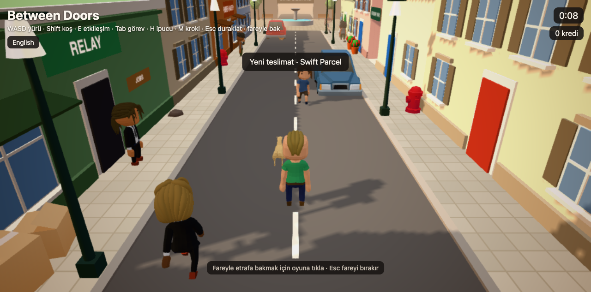

*A real screenshot of the finished game: the third-person street view with the HUD (title and key help top left,
mission clock and credits top right, a notification at the top).*

<details>
<summary>The original design concept (from the design submission)</summary>

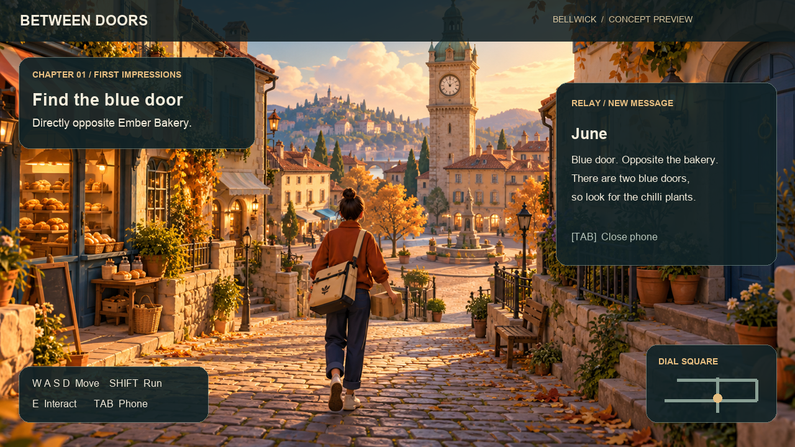

*Visual concept only: an AI-generated environment with separately composed interface overlays. The finished game
uses much simpler low-poly architecture (see the screenshot above).*
</details>

## Contents

- [Overview](#overview)
- [From design to finished game](#from-design-to-finished-game)
- [Story and characters](#story-and-characters)
- [The chapters](#the-chapters)
- [Gameplay and controls](#gameplay-and-controls)
- [How the game progresses](#how-the-game-progresses)
- [Number of tasks and lives](#number-of-tasks-and-lives)
- [The temporal component](#the-temporal-component)
- [Score, credits and upgrades](#score-credits-and-upgrades)
- [High scores and achievements](#high-scores-and-achievements)
- [Frontend layout](#frontend-layout)
- [Spatial thinking and geographic data](#spatial-thinking-and-geographic-data)
- [Requirements and acceptance criteria](#requirements-and-acceptance-criteria)
- [Technical architecture and libraries](#technical-architecture-and-libraries)
- [Implementation: event handlers, closures and the DOM](#implementation-event-handlers-closures-and-the-dom)
- [UML diagrams](#uml-diagrams)
- [Data and persistence](#data-and-persistence)
- [Project structure](#project-structure)
- [Development plan](#development-plan)
- [Running and building](#running-and-building)
- [Documentation and references](#documentation-and-references)

## Overview

| Item | Final game |
|---|---|
| Genre | Single-player exploration, light spatial puzzles and story |
| Perspective | Third-person, behind-the-character camera |
| Setting | Bellwick, a fictional neighbourhood of 7 districts, built from GeoJSON map data |
| Target platform | Desktop browser (Chrome or Edge recommended); keyboard and mouse |
| Language | English and Turkish (switchable at any time) |
| Scope | A courier's first working week: 5 days, 7 story chapters, plus side jobs from a job board |
| Playtime | The 7 chapters' target times add up to about 14 minutes of active delivery; a full week with side jobs and exploration takes considerably longer |
| Art direction | Stylised low-poly models (CC0), afternoon lighting, synthesised music |
| Progression | Performance score, credits, a market stall with 5 upgrades and 4 vehicles, 5 achievements |
| Course | GMT 458 · Web GIS |

**Core loop:** Collect a parcel → read the delivery note → investigate or arrange a meeting → find the recipient →
deliver → receive feedback and credits → spend credits at the market stall.

**Day loop:** Each morning, take the day's story chapter from Mara at Relay → take side jobs from the job board →
after the chapter and at least 2 side jobs, clock off at Mara's desk → the next day starts.

## From design to finished game

The design submission planned a short, three-chapter game. During development the scope grew. The three
designed chapters were built as planned and became **day 1**, and four more days were added on top of them.

| Design submission | Final game |
|---|---|
| 3 chapters in one scene | 7 chapters over 5 days, in 7 districts |
| No forced deadline | Still none for story chapters; **timed side jobs** add real deadlines |
| No vehicles | 4 vehicles (bike, scooter, motorcycle, van) bought at the market stall |
| No live GPS | A **GPS** upgrade adds a live minimap; the default is still the static sketch map |
| 2 upgrades, 4 achievements | 5 upgrades + 4 vehicles, 5 achievements |
| English only | English and Turkish |
| Static HTTP hosting only | GitHub Pages **and** an offline build that opens with a double-click (`file://`) |
| Fictional local coordinates (a course compliance question) | The whole town is stored as **GeoJSON** layers and drawn both as the 3D world and as the 2D map |
| — | Side jobs (4 kinds), the Magpies (parcel thieves), story scenes, the rival courier Mr Crane |

Combat, multiplayer, building interiors, parcel physics and online accounts are still out of scope.

## Story and characters

Alex arrives for a first courier shift in Bellwick. The navigation app announces arrival in front of a blank wall.
Mara calls from the nearby delivery shop:

> "First shift? Over here. The map likes that wall."

Street numbers have changed, local directions rely on landmarks, and one old lane is missing from the map. Alex
gradually learns how the neighbourhood fits together.

On **day 1**, the apparently ordinary parcels contribute to a small gathering for **Arthur Reed**, Bellwick's retired
postman, on the anniversary of his first postal shift. The final parcel of the day is an album of photographs and
residents' notes. Reaching Arthur's overlooked home brings the day's tasks together.

On **days 2–5** the week gets harder. A rival company, **Swift Parcel**, promises to be faster than Relay, and a gang
of parcel thieves, **the Magpies**, starts snatching parcels in the streets. Alex helps Arthur on his old round,
follows a thief back to the gang's den, and on the last day the whole neighbourhood meets at the Market Cross.

| Character | Role |
|---|---|
| **Alex** | The player's courier; unfamiliar with Bellwick at the beginning |
| **Mara** | Owner of **Relay**, the delivery shop; gives the story tasks and closes each working day |
| **June** | The first recipient; a photographer who helps later in the week |
| **Finn** | A walking customer; agrees on a meeting point with the player, and later plans the stakeout |
| **Arthur Reed** | The retired postman at the heart of the story |
| **Sylvie** | Supplies an old photograph and a note (no separate animated NPC) |
| **Mr Crane** | Runs Swift Parcel, the rival delivery company |
| **The Magpies** | Parcel thieves in black and white, from day 2 |
| **The stallholder** | Sells upgrades and vehicles at the Market Hill stall |

June is a resident, not the owner of Ember Bakery. The bakery remains a visual landmark.

## The chapters

### Day 1, chapter 1: First Impressions (read the place)

**Objective:** Deliver June's parcel to the correct blue door.

> "Blue door, directly opposite Ember Bakery. Look for the chilli plants."

- Find the bakery and compare two blue doors.
- Use both the spatial relationship and the visible plants to identify one correct target.
- Knock, confirm the recipient and hand over the parcel.
- A distinct wrong door costs score but does not lose the parcel or reset the mission.
- June contributes a photograph envelope for Mara. The unscored return introduces Arthur briefly.

**Introduces:** Movement, camera, task panel, interaction and landmark-based reasoning.

### Day 1, chapter 2: Crossing Paths (choose the meeting)

**Objective:** Deliver gathering decorations to Finn.

> "Walking towards Dial Square. Red jacket, green bag. Where should we meet?"

The player chooses between:

| Meeting point | Trade-off |
|---|---|
| **The fountain in Dial Square** | Familiar and easy to recognise, but reached by a slightly longer route |
| **Crossing Yard** | Closer, but requires finding its signed entrance and opening the courtyard gate |

Finn follows his route, accepts one meeting and waits at its destination. Missing him does not fail the chapter.
Once confirmed, the meeting cannot be changed. Both routes are viable. After delivery, the courtyard shortcut stays
open for the rest of the game. If the player arrives early at the confirmed meeting point, unavoidable waiting is
excluded from active time.

The decorations carry the words **"Forty years. Thousands of doors."** The chapter shows the game's main idea: the
player helps decide **where** a delivery happens.

### Day 1, chapter 3: Between Doors (find the forgotten address)

**Objective:** Deliver the completed album to Arthur at **Postmark Mews, last house on the lane**.

The phone reports **"Address not found."** Mara supplies the old gate key. Sylvie's photograph shows a broken stone
wall, a leaning tree and a faded postal sign. A similar old gate on the other side of the square is a decoy.

The player compares the photo with the present-day street, finds the real entrance, inspects the sign, opens the
gate and reaches Arthur. Postmark Mews is then added to the player's sketch map.

> Arthur: "Who told you the way?"
> Alex: "The neighbourhood did."

The album reveal, final dialogue and the gathering picture play before the results.

### Days 2–5

| Day | Chapter | The task | What it adds |
|---|---|---|---|
| 2 | **Swift Parcel** | "The stall at the top of Market Hill. Straight there, no detours." | The Magpies: a thief snatches the parcel; chase him and grab it back |
| 3 | **Arthur's Round** | "Meet Arthur on Lock Street, Canal Side. Then: *The Lockkeeper's House*, no number." | A far district; an address with a name instead of a number |
| 4 | **Stakeout** | "Finn, top of Yard Road. Carry the decoy, let them take it, follow. Bring proof to June." | Following instead of finding: let a thief take a decoy and track him to the den |
| 5 | **The Neighbourhood Did** | "Arthur, Market Cross, noon. Mr Crane will be there too." | The finale with the whole neighbourhood |

After the week ends, the town stays open for free play and side jobs.

## Gameplay and controls

| Input | Action |
|---|---|
| W / A / S / D or arrows | Move relative to the camera (steer when riding) |
| Mouse | Rotate the third-person camera (click the game to capture the mouse) |
| Shift | Run |
| E | Contextual interaction: inspect, knock, talk, deliver, take a parcel, get on or off a vehicle |
| Tab | Open or close the task panel |
| H | Take a hint |
| M | Open or close the sketch map (drag to move, wheel or + / − to zoom, 0 to centre) |
| Esc | Pause and settings |

### World and presentation

- **7 districts:** Indigo Row and Dial Square (the centre), Market Hill, Canal Side, Railway Yard, Hillside Park and
  Postmark Mews. Unvisited districts stay blank on the sketch map until you walk into them.
- Low-poly buildings and street furniture from reusable CC0 model kits; animated townsfolk and animals.
- **One task panel** holds the note, clues and hints, plus the side jobs you are carrying with their countdowns.
- A **static sketch map** (no "you are here") is the default. The GPS upgrade adds a live minimap and position.
- A parcel is an inventory state and a carry animation, not a physical object.
- Short text dialogue with fixed camera shots; music is synthesised in the browser.
- Graphics quality (Auto / High / Low): *Auto* measures the first seconds of play and switches to *Low* on slow
  machines.

Basic map access, readable text and settings are available without buying anything.

## How the game progresses

The game is a **working week**. Each day opens new places, adds new rules and gives longer routes.

| Day | Chapter(s) | Target time R | What gets harder |
|---|---|---|---|
| 1 | First Impressions · Crossing Paths · Between Doors | 60 s · 75 s · 90 s | Learning to read landmarks, a moving recipient, a missing address |
| 2 | Swift Parcel | 120 s | **Thieves appear** and steal parcels in the street |
| 3 | Arthur's Round | 150 s | A far district and an address without a number |
| 4 | Stakeout | 200 s | Following a moving target over a long route |
| 5 | The Neighbourhood Did | 120 s | The finale |

Difficulty grows in four ways:
1. **Distance:** routes start in the small centre and move out to the outer districts.
2. **Harder notes:** from a clear landmark, to a moving person, to an address with no number.
3. **New threats:** from day 2, Magpie thieves wait on some streets and snatch the parcel you carry.
4. **More to manage:** side jobs with deadlines and fragile parcels run beside the story.

A day ends only after its story chapter(s) **and at least 2 side jobs** are done; then Alex clocks off at Mara's desk.
A chapter unlocks when the previous one is finished **and** its day has come. Finished chapters can be replayed
from the *Chapters* menu.

## Number of tasks and lives

### Tasks
- **7 story chapters** (3 on day 1, then one per day).
- **Side jobs** from the Relay job board: **4 offers at a time**, to **23 addresses** in the outer districts, in
  **4 kinds**:

  | Kind | Rule |
  |---|---|
  | Plain | No rush |
  | Timed | A countdown; late means failed and unpaid |
  | Fragile | Bumps and running on foot damage the parcel; a damaged parcel pays less |
  | Redirect | A note on the first door sends you on to a second address |

- At least **2 side jobs per day** are needed to end the day, so a full week has **at least 10 side jobs**. There is
  no upper limit; the board refreshes after every job.

### Lives
**There are no lives.** A chapter cannot be lost or reset by a mistake. Mistakes cost **points, time or money**:

| Mistake | Cost |
|---|---|
| Knocking on a wrong door | −100 points (each distinct wrong door counts once) |
| Hints | −50 for the first, −100 for the second |
| Being slow | A smaller time bonus, or none |
| Missing a timed job's deadline | The job fails and pays nothing |
| A damaged fragile parcel | Lower pay (never below 40%) |
| A thief runs off with the parcel | Chase him and press E to grab it back, or recover it from the crate in his den |

This was a deliberate design choice: the game is about learning a place. Getting lost should cost you, but it
should not throw you out of the story.

## The temporal component

Time matters at three levels:

1. **Mission clock (every chapter).** It starts when you take the parcel and is always visible in the top-right
   corner. Your delivery time sets the time bonus (up to +200 points, see below). Only **active play** counts: the
   clock stops for story scenes, menus, a hidden browser tab and unavoidable waiting at a confirmed meeting point.
   It keeps running while the task panel or the map is open, so stopping to study the map costs time.
2. **Deadlines (timed side jobs).** A timed job allows `25 s + distance ÷ 3.2 m/s`: enough for a brisk walk, not for
   wandering. When the countdown reaches zero the job fails. Running, or riding a vehicle, beats it comfortably.
3. **The week.** The story runs over 5 days. What happens depends on the day: thieves appear from day 2, the market
   stall gets new goods, and each day ends only after its work is done.

Time is also the trade-off in fragile jobs: running is faster, but it damages the parcel.

## Score, credits and upgrades

### Performance score

Each chapter starts with **1,000 base points**.

```text
baseScore    = max(100, 1000 − 100 × distinctWrongTargets − hintCosts)
chapterScore = baseScore + timeBonus
```

- A distinct wrong door costs **100 points**; repeating the same wrong door in the same attempt costs nothing more.
- Two sequential hints cost **50** and **100** points; reopening a used hint is free.
- Reading the note or photograph again and the normal meeting choice are not paid hints.

For active time `T` and the chapter's reference time `R`:

| Active time | Bonus |
|---|---:|
| `T ≤ R` | +200 |
| `R < T ≤ 1.5R` | +150 |
| `1.5R < T ≤ 2R` | +100 |
| `T > 2R` | +0 |

The maximum is **1,200 per chapter** and **8,400 for the week**. The result screen shows each line of the calculation.

### Credits

Credits are separate from points. Each chapter's **first completion grants 100 credits**, even after a poor
performance; replays give none. Side jobs pay `20 + 0.22 × distance (m)`, multiplied by ×1.3 (timed),
×1.4 (fragile) or ×1.25 (redirect).

### Market stall

| Item | Cost | Effect |
|---|---:|---|
| **Compass** | 100 | Shows which way you are facing; does not reveal the target |
| **Steady Pace** | 100 | Run 10% faster; walking is unchanged |
| **GPS** | 150 | Shows your position on the minimap and on the sketch map |
| **Haggling** | 150 | Everything else at the stall costs 15% less |
| **Bag** | 200 | Carry two side jobs at once |
| **Bike / Scooter / Motorcycle / Van** | 120 / 300 / 600 / 900 | Faster travel for side jobs |

New goods appear on later days. Owned items cannot be bought again, and nothing is required to finish the game.
**Story deliveries are always made on foot:** if you ride up to a story task, the vehicle is parked there. Results
record the equipment used, so attempts with different abilities are not presented as identical.

## High scores and achievements

- Each chapter keeps **two records**: the **best score** and the **best time**, each from one whole attempt.
- Replaying a chapter can improve a record; the result screen then says *"New best score!"*.
- Credits are paid once per chapter, so replays cannot be used to farm money.
- Records live in the browser's `localStorage` (see [Data and persistence](#data-and-persistence)).

| Achievement | Unlock condition |
|---|---|
| **First Delivery** | Complete First Impressions |
| **Clean Shift** | Finish a delivery without knocking on a wrong door (hints are allowed) |
| **Meet Me Halfway** | Meet Finn at an agreed spot and hand over his order |
| **Special Delivery** | Deliver the album to Arthur |
| **First Week** | Finish the courier's first week |

Achievements unlock once and are kept. The Special Delivery notification appears after the ending, not over
Arthur's dialogue.

## Frontend layout

The 3D view always fills the browser window. All interface elements are HTML/CSS (and SVG for the maps) laid over
the canvas, so text stays sharp at any resolution.

### Sketches

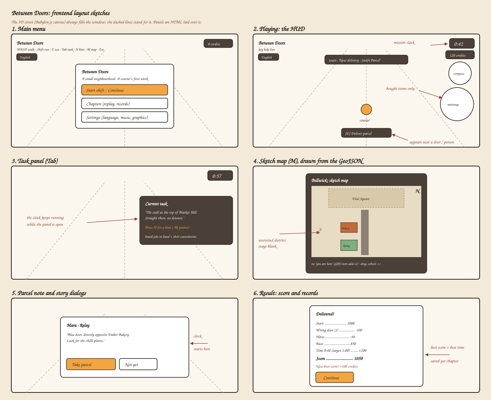

### The finished screens

| Main menu | Task panel (Tab) | Sketch map (M) |
|---|---|---|
| 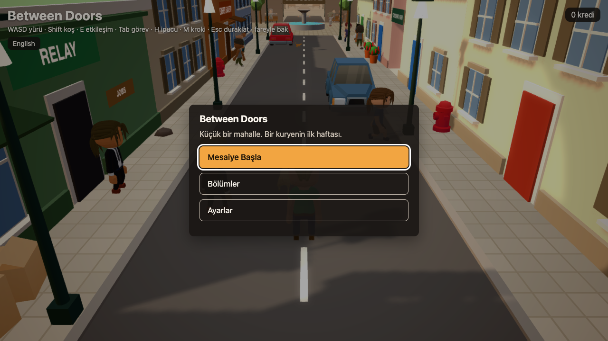 | 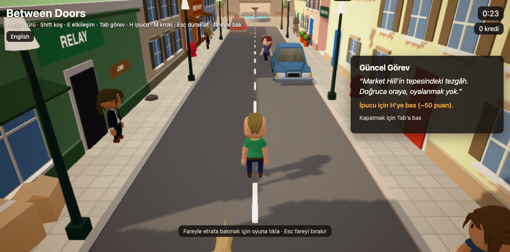 | 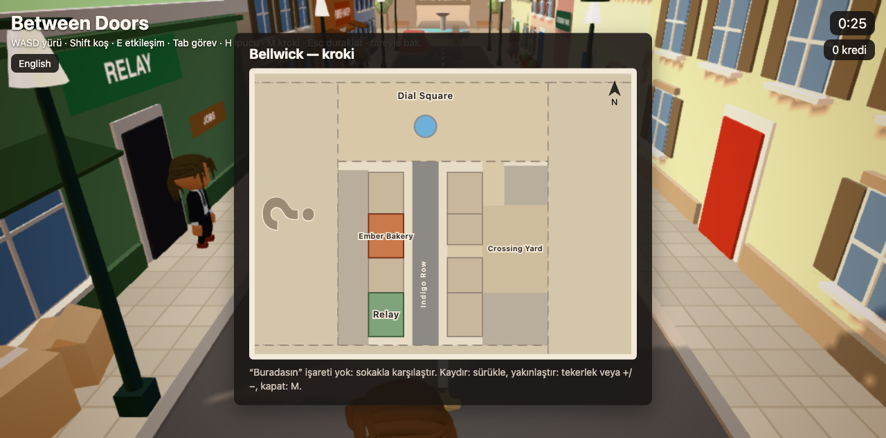 |

## Spatial thinking and geographic data

The game uses landmark relationships, visual comparison, route choice, meeting accessibility and learned shortcuts.
Players apply spatial reasoning without needing technical knowledge.

Delivery and address-clue puzzles have precedents, particularly **Letters to Arralla**. **Lake** also connects postal
work with community stories. This project does not claim to invent those ideas. Its identity is the combination of:

1. Interpreting informal directions.
2. Choosing a meeting point for a moving recipient.
3. Reusing knowledge of a compact neighbourhood that the player maps for themselves.
4. Connecting deliveries to one human story.

### The town as GIS data

The design submission noted that fictional 3D space alone might not satisfy a Web GIS course. In the final game the
whole town is **geographic data**: Bellwick is stored as **7 GeoJSON FeatureCollections**
(`src/content/world/*.geo.json`, **1,155 features**). Coordinates are local metres (`[x, z]`) rather than
latitude/longitude, because the town is fictional and must line up exactly with the 3D scene.

Each feature has a `properties.layer`, like layers in a GIS:

| Layer | Geometry | Count | Used for |
|---|---|---:|---|
| district | Polygon | 7 | Neighbourhoods; map discovery |
| area | Polygon | 103 | Roads, pavements, squares, parks, water |
| building / block | Polygon | 32 / 62 | Houses and building blocks |
| wall | Polygon | 61 | Fences and walls (also collision) |
| door / spot | Point | 24 / 40 | Delivery doors, addresses, interaction points |
| sign / label | Point | 11 / 32 | Street signs and map labels |
| poi / prop | Point | 595 / 165 | Trees, lamps, benches and other street furniture |
| marker / route | Point / LineString | 12 / 8 | Thief ambushes and escape paths, patrol routes |
| spawn / npc | Point | 1 / 2 | Start position, fixed characters |

`src/domain/world/worldData.ts` validates the data (schema, geometry types, every route vertex inside a district).
The **same data is drawn twice**: as the 3D town (`src/world/WorldBuilder.ts`) and as the 2D SVG sketch map and
minimap (`src/ui/MapView.ts`, `src/ui/mapLayers.ts`). No coordinate is copied into the code, so the map can never
disagree with the street.

**Spatial operations in the game:** point-in-polygon (which district the player is in, for map discovery),
distances (job pay and deadlines), nearest target inside a view cone (which door E knocks on), line following
(thieves and walking characters) and 2D collision against the wall and building polygons.

**Open data:** no external dataset is used; the town was drawn by hand as GeoJSON so the game works fully offline.
All 3D models are openly licensed (CC0), see `src/assets/models/CREDITS.md`.

## Requirements and acceptance criteria

### Functional requirements

| ID | Requirement | Acceptance criterion | Status |
|---|---|---|---|
| FR-01 | Start, continue and chapter access | A new profile starts at chapter 1; later chapters unlock after completion and on their day | ✅ |
| FR-02 | Third-person movement | Character moves, runs and collides with obstacles; camera stays usable | ✅ |
| FR-03 | Contextual interaction | Only an eligible nearby target responds; the action label is visible | ✅ |
| FR-04 | Single task panel | Notes and required clues can be reopened without duplicate charges | ✅ |
| FR-05 | Static map | Map opens independently and gains the final lane only after discovery | ✅ |
| FR-06 | Chapter flow | Parcel collection precedes handover; completion cannot settle twice | ✅ |
| FR-07 | Meeting choice | Both options send Finn to the correct reachable point, where he waits | ✅ |
| FR-08 | Shortcut | Crossing Yard is open from chapter 3 on, for either prior choice | ✅ |
| FR-09 | Photo and key | The final entrance is identifiable without hidden information; the key opens the intended gate | ✅ |
| FR-10 | Story and ending | Required conversations and the finale play in the intended order | ✅ |
| FR-11 | Wrong-target penalties | Each target is penalised only once per attempt | ✅ |
| FR-12 | Hints | Two sequential hints cost 50/100 once each | ✅ |
| FR-13 | Timing | Pauses and protected waiting do not inflate active time | ✅ |
| FR-14 | Score | Formula and all boundary values produce the defined result | ✅ |
| FR-15 | Credits | Each chapter grants its first-completion reward only once | ✅ |
| FR-16 | Purchases | Invalid, unaffordable or already-owned purchases are rejected | ✅ |
| FR-17 | Upgrade effects | Compass shows direction; Steady Pace affects running only | ✅ |
| FR-18 | Achievements | Each unlocks once; the final notification is deferred | ✅ |
| FR-19 | Save | Progress persists in a validated local snapshot | ✅ |
| FR-20 | Replay | Chapter state resets while profile progression remains; no repeat credit farming | ✅ |
| FR-21 | Days | A day ends after its story and 2 side jobs; the next chapter waits for its day | ✅ *new* |
| FR-22 | Side jobs | 4 job kinds; timed jobs fail at zero; fragile pay follows condition | ✅ *new* |
| FR-23 | Thieves | From day 2 a thief can snatch a carried parcel; it can be grabbed back or found in the den | ✅ *new* |
| FR-24 | Vehicles | Bought vehicles can be ridden; story deliveries are made on foot | ✅ *new* |
| FR-25 | Map discovery | Districts appear on the map after the player first walks into them | ✅ *new* |
| FR-26 | Language | English and Turkish; the choice is saved; no player-visible text in code | ✅ *new* |
| FR-27 | Graphics quality | Auto / High / Low; Auto drops to Low below 45 FPS | ✅ *new* |
| FR-28 | Offline delivery | The submission build opens from `file://` with no server and no internet | ✅ *new* |

### Quality requirements

| ID | Requirement | Status |
|---|---|---|
| NFR-01 | Reproducible install/build with pinned dependencies and a committed lockfile | ✅ `package-lock.json` |
| NFR-02 | Target at least 30 FPS at 1280×720 | ✅ Auto quality lowers settings when the measured rate is under 45 FPS |
| NFR-03 | Complete flow on desktop browsers; readable graphics/load error | ✅ Chrome and Edge tested; a clear message is shown when WebGL is missing. Safari not verified |
| NFR-04 | Readable text, non-colour-only clues, camera sensitivity and music volume | ✅ |
| NFR-05 | Loading indicator and recoverable asset errors | ✅ |
| NFR-06 | No account, precise GPS, email collection or cloud database | ✅ |
| NFR-07 | Detect invalid saves and storage failures; never silently erase progress | ✅ Old saves are migrated; a broken save can be downloaded before a reset |
| NFR-08 | Scoring and progression independent of rendering; no rules in UI code | ✅ `src/domain/` has no Babylon or DOM imports |
| NFR-09 | Record model, image and audio sources and usage rights | ✅ `src/assets/models/CREDITS.md` (all CC0; music is synthesised) |

**Tests:** 446 automated tests (Vitest) cover the rules, the content and the map data, including repeated penalties,
bonus boundaries, overlapping pause reasons, duplicate rewards, purchase validation, save migration and malformed saves.

## Technical architecture and libraries

| Tool | Purpose |
|---|---|
| **[Babylon.js](https://www.babylonjs.com/)** (`@babylonjs/core`, `@babylonjs/loaders`) | 3D engine: scene, lights, shadows, camera, animation, glTF model loading |
| **TypeScript** | Typed game state and rules; catches content mistakes (for example a quest pointing at a missing door) at build time |
| **Vite** | Development server and builds, including a custom build that opens from `file://` |
| **Vitest** | Unit tests for rules, content and map data |
| **HTML/CSS** | Interface overlay, without a UI framework |
| **SVG** (browser) | The sketch map and minimap, drawn directly from the GeoJSON, without a map library |
| **Web Audio API** (browser) | Synthesised music; no audio files |
| **Pointer Lock API** (browser) | Mouse look |
| **localStorage + JSON** | Versioned single-profile save |
| **Git** | Version control |

**Why Babylon.js and not Leaflet or OpenLayers?** The game is about recognising a place **at street level**: reading
doors, signs and landmarks the way a pedestrian sees them. That needs a 3D geovisualisation, not a top-down tile
map. The 2D view is still there, as the SVG sketch map drawn from the same GeoJSON layers.

The game is a static site: no game server is needed. It is published on GitHub Pages and also builds into an offline
package for the course submission.

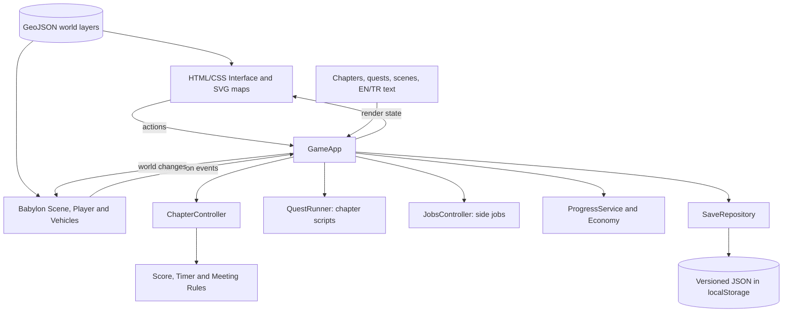

The domain layer does not import scene meshes or DOM components. `GameApp` coordinates progression and persistence;
the UI never calculates rewards itself.

**MVC:**
- **Model:** `src/domain/` (pure rules: score, timer, days, story order, quests, collision, thieves) and
  `src/content/` (chapters, quests, scenes, GeoJSON world).
- **View:** `src/world/` (3D scene), `src/player/` (character, vehicles, camera), `src/ui/` (HTML panels, maps).
- **Controller:** `src/app/` (`GameApp`, `ChapterController`): input → rules → view.

## Implementation: event handlers, closures and the DOM

### Three event handlers

1. **Keyboard input** (`src/app/InputController.ts:41`). `keydown` and `keyup` listeners on `window` keep a set of
   held keys (for walking) and a set of single presses (for E, Tab, H, M). Keys typed inside a dialog are ignored,
   so Tab and Enter still move between buttons. `preventDefault()` stops the arrow keys from scrolling the page and
   Tab from leaving the game. A `blur` listener releases every key when the window loses focus, so Alex does not keep
   walking alone.
2. **Hidden tab stops the clock** (`src/app/GameApp.ts:314`). A `visibilitychange` listener on `document` pauses the
   mission timer when the tab is hidden and resumes it when it is visible again. This is part of the temporal
   component: only active play is timed.
3. **Dragging the sketch map** (`src/ui/MapView.ts:196`). `pointerdown`, `pointermove` and `pointerup` on the map's
   `<svg>` let the player drag the map with a mouse or a finger. `pointermove` converts screen pixels into map metres
   with the SVG's screen matrix (`getScreenCTM()`) and moves the visible frame. `setPointerCapture` keeps the drag
   alive when the pointer leaves the map. A `wheel` handler zooms towards the point under the cursor.

### Closures

- **Seeded random numbers** (`src/domain/jobs/jobs.ts:53`). `seededRandom(seed)` returns a function that keeps its
  state `a` in a closure; every call advances `a` and returns the next number. The job board uses it, so the same
  day always offers the same jobs, which keeps the game fair and testable.
- **The map's private state** (`src/ui/MapView.ts:117` and `:194`). `openSketchMap()` declares `let frame` (the
  visible area) and `let drag` (the drag in progress) as local variables. All the map's event handlers close over
  them and share them, and nothing outside the map can change them. When the map closes, handlers and state are
  released together.
- **Buttons that remember their choice** (`src/app/GameApp.ts:1551`). `const choose = (id) => () => this.confirmMeeting(id);`
  creates one click handler per meeting point. Each handler remembers its own `id`, so it never has to be read back
  from the DOM.
- **Deferred callbacks.** "When this scene ends, emit an event" (`scene.play` with `then`) captures the values it
  needs when it is created and runs later.

### DOM interaction

- **UI built from code:** menus, dialogs, the task panel, the job board and the market stall are created with
  `document.createElement`, filled with `textContent` (never `innerHTML`, so game text cannot inject HTML) and
  swapped with `replaceChildren`. See the `el()` helper in `src/ui/UIController.ts:330`.
- **Cheap per-frame updates:** the clock (`UIController.setTimer`) writes to the DOM only when the displayed text
  changes, not on every frame.
- **SVG maps:** `src/ui/mapLayers.ts` creates SVG elements with `document.createElementNS` from the GeoJSON layers
  (`drawWorldLayers`); zooming and panning change the SVG `viewBox`.
- **Accessibility:** dialogs use `role="dialog"` and keyboard focus, the clock uses `role="timer"`, and hidden
  elements use the `hidden` attribute.
- **Language switch:** all visible text comes from `src/i18n/`; switching language re-renders the open panels.

## UML diagrams

### Use cases

Dashed `include` dependencies mean saving is part of the action, not a separate manual task.

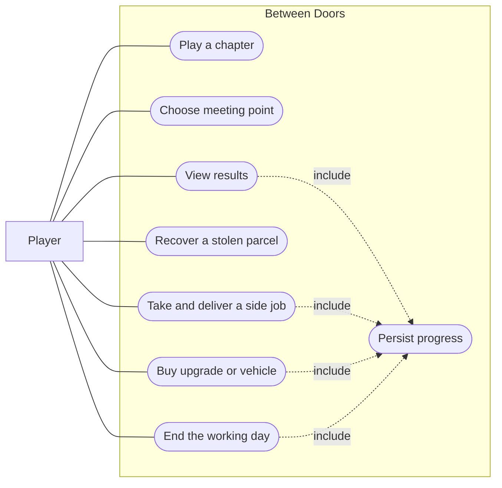

### Chapter state

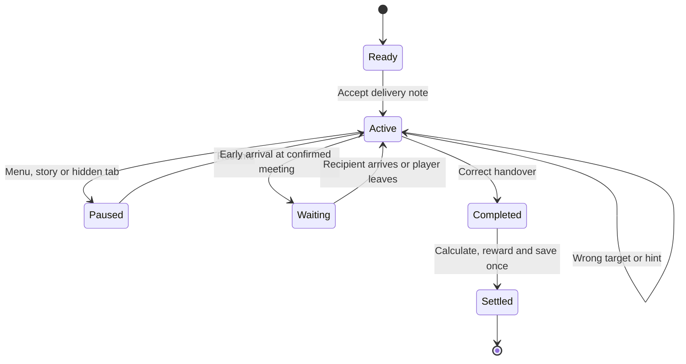

Pause reasons are kept as a set (`TimerService`), so overlapping reasons never subtract time twice. A replay creates
a new attempt rather than reopening a completed one.

### Class diagram

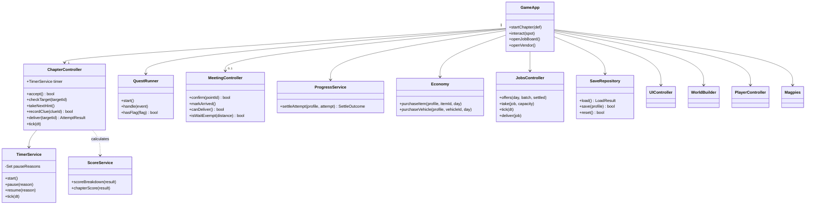

`ProgressService` returns an updated profile and does not write storage itself; `GameApp` passes the snapshot to
`SaveRepository`.

### Delivery settlement sequence

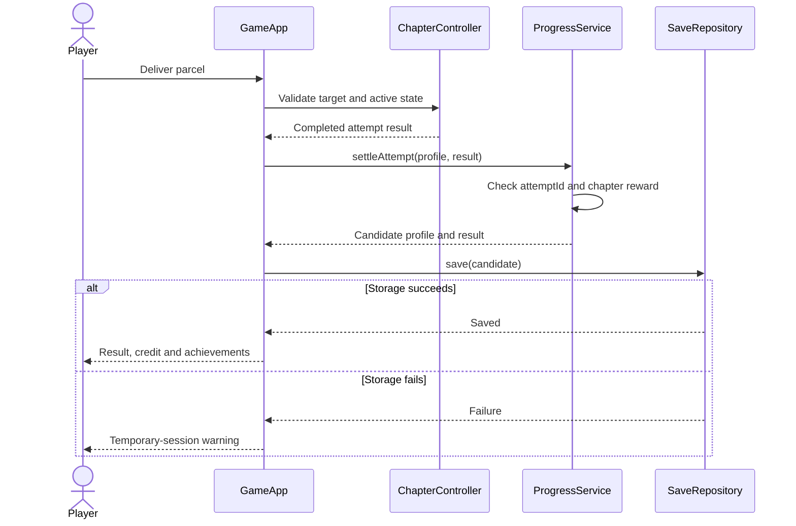

Repeated settlement never duplicates credits. A storage retry writes the existing candidate snapshot rather than
applying the reward again.

## Data and persistence

### Logical data model

This ER diagram describes relationships; it does **not** mean an SQL database is used. All entities are arrays or
records inside one JSON save.

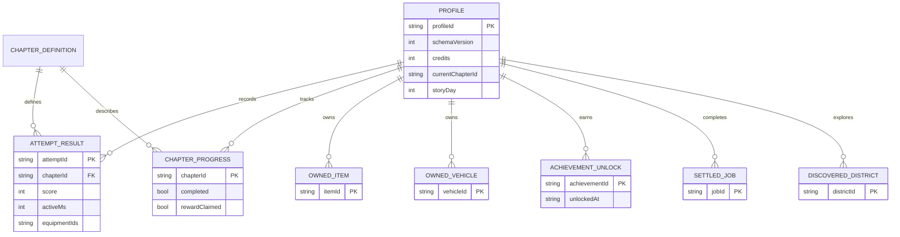

### Example save

Storage key: `betweenDoors.save.v6` (schema version 6). Saves from older versions (`…v1` to `…v5`) are read once
and upgraded by a chain of tested migration functions (`src/persistence/migrations.ts`); old keys are never deleted
without the player's confirmation.

```json
{
  "schemaVersion": 6,
  "profileId": "local",
  "credits": 340,
  "currentChapterId": "ch4",
  "storyDay": 2,
  "completedChapterIds": ["ch1", "ch2", "ch3"],
  "rewardClaimedChapterIds": ["ch1", "ch2", "ch3"],
  "ownedItemIds": ["compass"],
  "ownedVehicleIds": [],
  "achievementUnlocks": { "first_delivery": "2026-11-20T11:59:00Z" },
  "chapterRecords": {},
  "settledAttemptIds": ["…"],
  "discoveredDistrictIds": ["indigo-row", "dial-square"],
  "jobsCompleted": 3,
  "dayJobs": 1,
  "settings": { "musicVolume": 0.5, "sensitivity": 1.0, "language": "en", "quality": "auto" }
}
```

The example leaves out some fields and the result records for brevity. A result keeps its score, active time,
penalties, hints and equipment together.

**Integrity rules:**

- No negative credits, unknown items or repeated purchases.
- Prices are checked in the rules (`Economy`), never taken from the interface.
- Completion, reward flags, achievements and credits are stored in one candidate snapshot.
- Saves happen on meaningful transitions, not every frame.
- The last settled attempt and job IDs are kept; permanent chapter reward flags prevent replay farming.
- Malformed or unsupported saves are detected; the player can download a backup before an explicit reset.
- An unfinished chapter restarts from its beginning; owned items and credits remain.
- A save change from another tab is detected.
- Local saves can be edited or cleared by the browser or the user; no anti-cheat or cross-device sync is promised.

## Project structure

```text
between-doors/
├── README.md
├── BENIOKU.txt                 # Turkish quick-start for the submission zip
├── index.html
├── package.json / package-lock.json
├── vite.config.ts              # dev, web (GitHub Pages), offline zip and single-file builds
├── build/                      # build helpers (packs the 3D models for the offline build)
├── .github/workflows/pages.yml # test, build and deploy to GitHub Pages
├── docs/
│   ├── images/                 # screenshots
│   └── sketches/layout.svg     # frontend layout sketches
└── src/
    ├── main.ts
    ├── app/                    # Controller: GameApp, ChapterController, JobsController, input, scenes
    ├── domain/                 # Model (pure rules): score, timer, days, story, quests, jobs, chase,
    │                           #   collision, economy, world data validation
    ├── content/                # Model (data): chapters, quests, scenes, actors, clues, catalog, jobs
    │   └── world/*.geo.json    #   the town as GeoJSON layers
    ├── world/                  # View: 3D scene built from the GeoJSON
    ├── player/                 # View: character, camera, movement, vehicles
    ├── ui/                     # View: HTML panels, sketch map, minimap, compass
    ├── persistence/            # SaveRepository and save migrations
    ├── i18n/                   # English and Turkish text
    ├── audio/                  # synthesised music (Web Audio)
    └── assets/models/          # CC0 glTF models + CREDITS.md
```

Tests sit next to the code they test (`*.test.ts`). Generated `dist*` folders and `node_modules` are not source files.

## Development plan

- [x] Define the reduced three-chapter concept.
- [x] Document story, mechanics, requirements and technical architecture.
- [x] Prepare an interface concept image.
- [x] Build player movement, camera and collisions.
- [x] Complete chapter 1 from collection to results.
- [x] Implement and test score, timer, credits, purchases and save rules.
- [x] Implement Finn's two meeting options and the shortcut.
- [x] Add the final photo task and the illustrated ending.
- [x] Integrate achievements, progression and chapter replay.
- [x] Extend to a 5-day week: chapters 4–7, side jobs, thieves, vehicles, market stall.
- [x] Move the town into GeoJSON layers; draw the 3D world and the maps from the same data.
- [x] Add Turkish, graphics quality settings and synthesised music.
- [x] Offline build for the course submission; GitHub Pages deployment.
- [ ] Test with unfamiliar players and simplify unclear clues.
- [ ] Record a gameplay video.

**Definition of done (from the design):** a new player can finish the chapters without verbal coaching; all
progression persists correctly; recipients stay reachable; the game can be finished without upgrades; and the
finale comes before the overall results.

## Running and building

**Play:** https://emrecigil.github.io/between-doors/, or double-click `index.html` in the `OYUN/` folder of the
submission zip (no installation, no internet).

**From source** (Node.js 20+):

| Command | What it does |
|---|---|
| `npm install` | Install dependencies |
| `npm run dev` | Development server with hot reload |
| `npm test` | Unit tests (Vitest) |
| `npm run typecheck` | TypeScript type check |
| `npm run build:web` | Web build in `dist-web/` (used for GitHub Pages) |
| `npm run build` | Offline build in `dist/`: `index.html` + `game.js` + model packs; opens from `file://` |
| `npm run build:single` | Backup: everything in one `dist-single/index.html` |

Every push to `main` runs the tests, builds the web version and publishes it to GitHub Pages
(`.github/workflows/pages.yml`).

<!-- AI section ("What I learned from AI" + link to the conversation): to be added. -->

## Documentation and references

- [Detailed Turkish requirements and technical design (PDF)](docs/requirements-and-technical-design-tr.pdf)
- [Babylon.js documentation](https://doc.babylonjs.com/)
- [Babylon.js glTF loader](https://doc.babylonjs.com/features/featuresDeepDive/importers/glTF)
- [GeoJSON specification (RFC 7946)](https://datatracker.ietf.org/doc/html/rfc7946)
- [Vite guide](https://vite.dev/guide/)
- [Vitest guide](https://vitest.dev/guide/)
- [MDN localStorage](https://developer.mozilla.org/en-US/docs/Web/API/Window/localStorage)
- [MDN Pointer Lock API](https://developer.mozilla.org/en-US/docs/Web/API/Pointer_Lock_API)
- [MDN Web Audio API](https://developer.mozilla.org/en-US/docs/Web/API/Web_Audio_API)
- Comparison: [Letters to Arralla](https://store.steampowered.com/app/2189310/Letters_to_Arralla/) and [Lake](https://store.steampowered.com/app/1118240/Lake/).

**Credits and rights:** 3D models by Quaternius, Kenney and KayKit (CC0), listed with sources in
`src/assets/models/CREDITS.md`. Music is synthesised in the browser. The design concept image was generated with an
AI image tool, with the interface composed separately; it is not used in the game.

**Design author:** Rabia Demir · GMT 458 · Web GIS
**Final submission updated:** 23 November 2026
